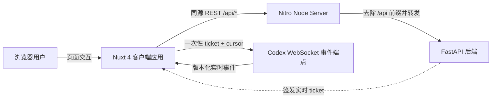
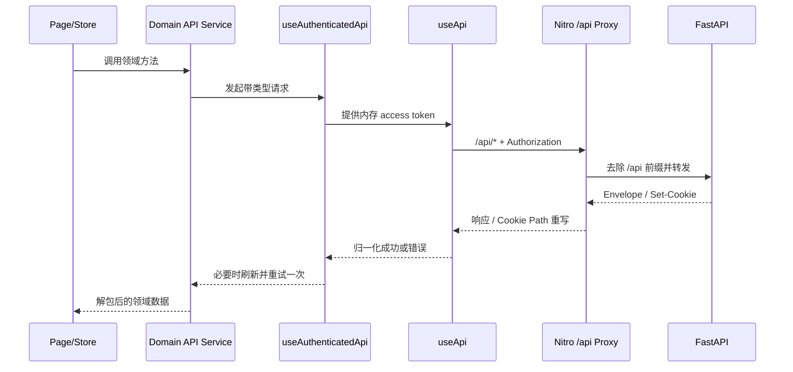
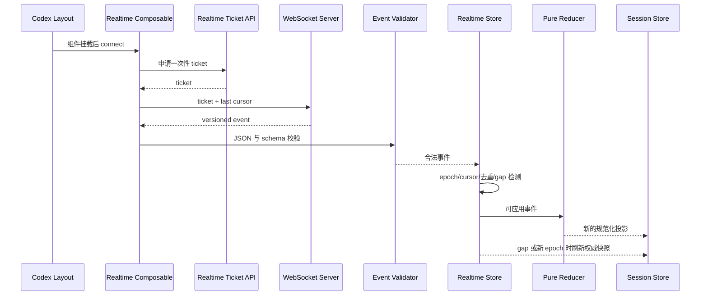

# Nuxt 全栈前端架构分析与演进建议

> 分析日期：2026-08-11  
> 分析范围：当前工作区中的 Nuxt 应用、Nitro 服务端代理、前端测试与交付配置。后端 FastAPI 源码不在本工作区内，因此对后端的判断仅基于前端契约、代理配置和部署说明。

## 1. 结论摘要

当前项目不是单纯的 Vue 单页应用，而是一个以 Nuxt 4 为运行框架的全栈前端服务：浏览器端负责页面、会话内存状态和实时交互，Nitro 负责 Node 服务交付与同源 REST 代理，FastAPI 后端负责认证、授权、业务数据和 Codex 实时事件。

整体可定义为一个“按业务域分区的前端模块化单体”，主要包含两个业务域：

- 后台管理域：身份、角色、Scope、审计、运维、安全和系统状态。
- Codex 远程控制域：主机、工作区、线程、实时事件、审批、设备和执行策略。

架构的成熟部分集中在安全边界、API 契约、实时事件恢复和测试门禁；当前主要问题不是缺少基础设施，而是业务增长后出现了若干集中复杂度：大型 API 文件、大型状态编排 Store、页面内重复的服务端状态管理，以及路由权限信息的多处声明。

建议继续维持单仓、单 Nuxt 应用和单部署单元，不需要引入微前端。近期演进重点应是收紧模块边界、拆分编排职责和建立契约自动校验。

## 2. 系统上下文



在本地 Docker 的默认配置中：

- 浏览器 REST 基址为 `/api`，从而保持同源请求。
- Nitro 将 `/api/*` 转发到 `NUXT_API_BASE_URL` 指向的 FastAPI。
- Nitro 重写浏览器刷新 Cookie 的 Path，使后端 `/auth/browser` Cookie 可以在公开的 `/api/auth/browser` 路径下生效。
- WebSocket 不经过当前 Nitro REST 中间件，生产环境需要 HTTPS 网关额外代理 `/codex/events`，或者显式配置 WebSocket 基址。

## 3. 运行时形态

### 3.1 Nuxt 与渲染策略

项目全局支持 SSR，Nitro 使用 `node-server` preset 构建 Node 服务，但核心业务路由通过 `routeRules` 关闭了 SSR：

- `/`、`/login`、`/register`
- `/account/**`
- `/admin/**`
- `/codex/**`

这样做的直接原因是会话恢复依赖浏览器 Origin 和 HttpOnly 刷新 Cookie。访问令牌不会进入 Nuxt SSR payload，首次渲染和 hydration 之间也不会因为服务端缺少会话而产生明显 DOM 差异。

因此，项目当前的实际产品形态更接近“由 Nuxt/Nitro 托管的 CSR 应用”，而不是内容型 SSR 网站。Nitro 的主要价值是统一交付、运行时配置和同源 API 代理。

### 3.2 部署与容器

交付链路采用多阶段 Docker 构建：

1. 固定 pnpm 版本并安装锁定依赖。
2. 在 builder 阶段执行 Nuxt production build。
3. runtime 镜像只复制 `.output`。
4. 使用非 root 用户运行 Node 服务。

Compose 进一步启用了只读根文件系统、`tmpfs`、能力清空、`no-new-privileges` 和 PID 限制。该部分属于当前架构中边界较清晰、生产意识较强的一层。

## 4. 代码分层

| 层级       | 主要位置                     | 当前职责                                                     |
| ---------- | ---------------------------- | ------------------------------------------------------------ |
| 应用壳     | `app/app.vue`、`app/layouts` | 全局错误边界、标题、主题、导航和各业务域布局                 |
| 路由页面   | `app/pages`                  | 页面元数据、权限声明、视图编排和交互状态                     |
| 组件       | `app/components`             | 基础控件、反馈组件、后台组件和 Codex 领域组件                |
| 组合式逻辑 | `app/composables`            | API 调用包装、鉴权重试、主题、断点和实时连接生命周期         |
| 全局状态   | `app/stores`                 | 认证状态、应用 UI 状态、Codex 会话投影、实时连接、审批与设备 |
| 领域 API   | `app/services/api`           | 按资源封装后端路径、请求体、幂等键和响应解包                 |
| 类型与契约 | `app/types`                  | API Envelope、认证、路由元数据和各业务域数据结构             |
| 纯函数工具 | `app/utils`                  | 路由注册表、错误归一化、实时事件校验/归并、Markdown 和主题   |
| 服务端适配 | `server`                     | `/api` REST 反向代理、Cookie Path 与转发头处理               |
| 质量保障   | `tests`                      | 纯单元测试、Nuxt 集成测试和 Playwright E2E                   |

Nuxt 自动导入覆盖 `composables/**`、`stores/**`、`utils/**` 和 `services/api/**`，组件也关闭了路径前缀。这降低了页面噪音，但也使依赖关系不完全显式，后续拆分领域目录时需要关注命名冲突和跨域调用。

## 5. 核心调用链

### 5.1 普通 REST 请求



`useApi` 是底层传输边界，负责：

- 读取运行时 API 基址和超时。
- 根据公开端点和请求元数据决定是否附加认证。
- 阻止携带认证信息访问非配置源的绝对 URL。
- 使用统一的错误归一化逻辑返回 `ApiErrorPayload`。

`useAuthenticatedApi` 在其上增加：

- 从 Auth Store 读取内存访问令牌。
- 仅在明确的 token expired 错误上触发刷新。
- 刷新成功后将原请求重试一次，并通过 `skipRefresh` 防止循环。

领域 Service 再负责路径、请求模型、响应 Envelope 和契约版本，不让页面直接拼接后端 URL。

### 5.2 登录与会话恢复

认证模型采用“内存访问令牌 + HttpOnly 刷新 Cookie”：

1. 登录接口通过 `credentials: include` 获取访问令牌，同时由后端设置刷新 Cookie。
2. 访问令牌只保存在 Pinia Auth Store 内存中，不写入 localStorage、Cookie 或 Nuxt payload。
3. 页面刷新后，客户端调用 browser refresh 接口恢复访问令牌，再请求 `/auth/me` 获取主体、角色和 Scope。
4. 刷新请求在 Store 实例内去重；浏览器支持 Web Locks 时，还会使用锁降低同一浏览器中的并发刷新竞争。
5. 注销时本地清理是权威动作，后端 revoke 为尽力而为。

该设计降低了访问令牌长期落盘和刷新令牌被 JavaScript 读取的风险。它同时解释了核心会话页面关闭 SSR 的架构选择。

### 5.3 路由与权限

全局路由中间件统一处理：

- 页面标题。
- guest-only 页面跳转。
- 认证初始化与登录重定向。
- Runtime Feature Flag。
- Role、Scope、Permission Mode 和 Admin Boundary Policy。

后台权限被进一步抽象为三类边界：Public、BusinessAdmin 和 OpsOnly。导航项也通过相同的 Auth Store 能力判断过滤，因此“页面能否进入”和“导航是否出现”共享同一套判定函数。

需要强调：前端路由守卫和功能开关只负责用户体验与减少误操作，安全边界必须继续由 FastAPI 对每个 API 请求执行认证和授权。

### 5.4 Codex 实时链路



这一链路的设计质量较高，具有以下特征：

- WebSocket URL 只携带一次性 ticket，不暴露 access token、refresh token 或本机路径。
- 事件带 `schema_version`、`stream_epoch`、`cursor` 和 `event_id`。
- 客户端先执行运行时结构校验，再进入状态归并。
- Realtime Store 负责连接状态、事件去重、cursor 和 gap 检测。
- 纯 Reducer 负责把事件归并为 hosts、workspaces、threads、turns 和 items 的规范化投影。
- gap 或新 stream epoch 会触发 REST 权威快照刷新，而不是盲目信任残缺的增量流。
- 重连使用带抖动的指数退避，并处理离线、页面可见性和空闲超时。
- 命令类请求使用幂等键；用户消息先乐观插入，收到权威事件后再协调替换。

这已经接近一个小型事件驱动客户端，而不是普通的“WebSocket 收到消息后直接改页面”。

## 6. 业务域划分

### 6.1 后台管理域

后台管理页面复用 `AdminTable`、`AdminToolbar`、`AdminPagination` 和 `AdminCard`，领域 Service 按 Identity、Audit、Security 和 Ops 暴露客户端入口。

后台响应不仅检查外层通用 Envelope，还检查内层：

- `schema_version`
- `kind`
- `operation_name`
- `detail`

这使前后端契约漂移可以在客户端边界处尽早失败，并转化为明确的 502 contract error，而不是在页面深处产生不确定的空值错误。

当前不足是所有后台端点仍集中在 `app/services/api/admin.ts` 中，文件已接近 800 行。虽然对外暴露了多个 client factory，但物理文件边界没有跟上业务边界。

### 6.2 Codex 域

Codex 域已经形成相对完整的内部子系统：

- `services/api`：hosts、workspaces、threads、realtime、approvals、devices、access、enrollment 等资源客户端。
- `stores`：会话投影、实时连接、审批、设备和 UI 草稿。
- `utils`：事件校验、事件 Reducer、diff、Markdown 与内容上限。
- `components/codex`：Timeline、Composer、Diff、Plan、Command Output 和连接状态。
- `layouts/codex.vue`：桌面侧栏、移动底部导航和实时连接生命周期。

该域的主要集中点是 `codex-session.ts`。它同时承担资源加载、选择状态、命令编排、历史分页、幂等控制、乐观更新、权限策略收敛和实时事件投影入口，已经超过单一 Store 最舒适的职责范围。

## 7. 状态管理策略

当前 Pinia 状态可以分为三类：

- 身份状态：Auth Store 保存访问令牌、主体、权限与认证状态机。
- 领域状态：Codex Session/Realtime/Approvals/Devices 保存跨页面共享数据。
- 纯 UI 状态：侧栏开关、草稿等不需要后端权威性的状态。

Codex 规范化投影采用 `byId` 字典和每线程有序 ID 列表，适合增量事件归并，避免深层数组反复查找和替换。事件 Reducer 保持纯函数，也显著提高了可测试性。

后台管理页面则主要在页面内部用 `ref` 管理列表、筛选、分页、loading、saving 和消息。这对少量页面足够直接，但随着页面数量增长，已经出现重复的请求生命周期代码。

## 8. UI 与设计系统

UI 基础层包含 BaseButton、BaseInput、BaseSelect、BaseModal、BaseBadge 和 Loading 等组件，业务域在其上构建后台和 Codex 组件。

样式采用 Tailwind CSS 4，并在 `main.css` 中定义语义设计令牌：canvas、surface、ink、line、primary、warning 和 danger，明暗主题通过 `data-theme` 切换。全局样式还处理了：

- focus-visible 轮廓。
- 链接可辨识性。
- reduced-motion。
- 横向溢出。
- Markdown 长文本和代码换行。
- 移动端后台工具栏布局。

默认布局包含跳转到主内容的无障碍链接；Nuxt 同时启用了 `@nuxt/a11y`。整体属于轻量设计系统，而非简单页面级样式堆叠。

## 9. 测试与质量门禁

测试体系分三层：

| 类型          | 工具                        | 重点                                                |
| ------------- | --------------------------- | --------------------------------------------------- |
| 纯单元测试    | Vitest node                 | Proxy、错误、事件 Reducer、Diff、Markdown、交付配置 |
| Nuxt 集成测试 | Nuxt Test Utils + happy-dom | Auth、RBAC、页面、API、组件、主题、实时连接         |
| E2E           | Playwright                  | 冒烟流程和 Codex 移动端交互                         |

`verify` 串联格式检查、Lint、类型检查、单元/集成测试、覆盖率、生产构建和 E2E。覆盖率阈值当前为 statements/lines 50%、branches 40%、functions 35%，重点文件被显式列入统计。

项目还通过测试审计部分交付约束，例如：

- 会话页面必须关闭 SSR。
- E2E 使用隔离端口且不复用未知服务。
- API 超时回退行为固定。
- Docker Compose 本地启动前必须重建镜像。
- 中文发布文本不得出现已知乱码标记。

不足是仓库当前没有 `.github/workflows`，完整门禁仍依赖本地或外部流水线主动执行 `pnpm release:check`。

## 10. 当前优势

1. 安全模型一致：令牌存储、Cookie、同源代理、外部绝对 URL 限制和路由权限形成了可解释的边界。
2. API 边界清楚：页面不直接依赖 `$fetch`，错误和 Envelope 在统一层处理。
3. 契约意识强：后台 Envelope 和 Codex 实时事件都有运行时校验与版本字段。
4. 实时恢复可靠：cursor、epoch、去重、gap、权威快照和退避重连形成闭环。
5. 测试覆盖架构关键点：测试不仅覆盖组件，也覆盖交付规则和安全假设。
6. 部署单元简单：一个 Nuxt Node 服务即可承载静态资源、页面和 REST 同源代理。
7. UI 基础设施已成型：基础组件、设计令牌、主题和无障碍约束具有复用价值。

## 11. 主要风险与技术债

### 11.1 高优先级：路由权限存在多处事实来源

后台路由注册表定义了一套标题、描述、角色、Scope、边界和 Feature Flag；各页面的 `definePageMeta` 又重复声明一套；导航组件还会再读取注册表过滤。

当前测试覆盖了中间件行为，但如果新增页面时注册表和 Page Meta 只改一处，可能出现“导航隐藏但 URL 可进入”或“导航可见但页面 403”的漂移。

建议先增加注册表与页面元数据的一致性测试，再评估是否用可导入的静态 Page Meta 常量减少重复。不要依赖人工审查维持长期一致性。

### 11.2 高优先级：大型编排模块继续增长

当前显著的复杂度热点包括：

- `app/services/api/admin.ts`：约 793 行。
- `app/stores/codex-session.ts`：约 509 行。
- 多个后台/Codex 页面超过 300 行。

这些文件目前仍有清晰命名和测试支撑，但继续添加端点和命令会提高变更冲突与回归概率。

建议按现有领域自然边界拆分，而不是创建通用抽象：

- Admin Service 拆为 identity、audit、ops、security、system。
- Codex Session 保留可观察状态，把资源加载、线程命令和执行策略计算提取为独立领域服务或 action composable。
- 页面将可复用的列表查询、分页和 mutation feedback 提取为后台专用 composable。

### 11.3 中优先级：服务端状态管理方式不统一

Codex 使用 Store + Reducer 维护跨页权威投影，后台页面则各自使用 `onMounted`、`ref` 和手写 loading/error。两者业务性质不同，不必强行统一，但后台页面已经重复实现搜索、分页、保存和刷新流程。

建议先建立小型的 `useAdminList`/`useAdminMutation` 模式，只有在缓存失效、请求去重和预取需求明显增加时，再引入 TanStack Query 等服务端状态库。当前没有必要仅为了形式统一而增加新依赖。

### 11.4 中优先级：后端契约仍主要靠手写同步

TypeScript 类型、路径、kind、operation name 和 schema version 都由前端手写维护。运行时校验能快速暴露漂移，但不能自动防止漂移。

建议从 FastAPI OpenAPI 生成只读契约快照，并在 CI 中做差异检查。对后台特有的双层 Envelope 和 WebSocket 事件，可继续保留现有手写适配层，不必强制完全代码生成。

### 11.5 中优先级：SSR 定位存在认知成本

项目配置和交付都保留 SSR 能力，但所有主要产品路由都关闭 SSR。新成员可能误以为页面具备完整服务端数据获取能力，随后在会话页面引入 SSR 调用并破坏凭据边界。

建议形成明确 ADR：

- 方案 A：承认产品是 CSR + Nitro Gateway，保留 Nuxt SSR 只为未来公开内容页。
- 方案 B：若未来确实需要受保护页面 SSR，则设计服务端可验证的会话机制，而不是直接把内存 access token 带入 SSR。

在没有明确业务需求前，建议采用方案 A。

### 11.6 中优先级：WebSocket 依赖外部网关配置

当前 Nitro 中间件只代理 REST `/api`，不会自动转发 WebSocket。生产部署若只配置了 REST 反代而漏掉 `/codex/events`，普通后台页面会正常，Codex 实时功能却会失败。

建议把 HTTPS 网关的 WebSocket 代理、超时和 Upgrade 头要求写入部署验收，并加入生产环境冒烟检查。

### 11.7 中低优先级：实时投影缺少总量回收策略

实时内容会限制单条文本和命令输出长度，事件去重列表也限制为 2,000 个 ID，但规范化投影中的线程、turn 和 item 总数没有明显的会话级回收策略。长时间运行并浏览大量线程时，客户端内存可能持续增长。

建议增加按最近线程、最大 item 数或页面离开策略进行回收，并确保恢复时仍以权威快照为准。

### 11.8 中低优先级：事件 ID 查重为线性扫描

`seenEventIds.includes` 最多扫描 2,000 项，当前上限下通常可接受。如果事件频率明显提高，可在 Store 外维护 Set 索引并与有序队列同步，避免把不可序列化结构直接放入 Pinia state。

### 11.9 中优先级：完整质量门禁未进入仓库 CI

`pnpm release:check` 已经足够完整，但没有仓库内流水线自动执行。随着多人协作增加，手动门禁会逐步失效。

建议至少建立一条 PR 流水线执行 format、lint、typecheck、Vitest 和 build；Playwright 可根据执行时长放在合并前必跑或夜间任务中。

## 12. 推荐演进路线

### 阶段一：稳定边界，不改运行模型

1. 增加路由注册表与 Page Meta 一致性测试。
2. 将 `admin.ts` 按领域拆文件，保持现有对外 API 形状不变。
3. 为生产网关增加 WebSocket 配置说明和冒烟测试。
4. 在仓库 CI 中接入现有 verify 子集。
5. 新增 ADR，固定“CSR 会话页 + Nitro 同源代理”的安全模型。

### 阶段二：降低业务编排复杂度

1. 把 Codex 资源加载、线程命令、执行策略计算从 Session Store 中拆出。
2. 保留纯事件 Reducer 作为投影的唯一增量更新入口。
3. 为后台列表和 mutation 建立领域级 composable，减少页面重复状态机。
4. 给实时投影增加容量和回收策略。

### 阶段三：强化前后端契约

1. 固化 FastAPI OpenAPI 快照。
2. 在 CI 中比较端点、请求模型和响应模型变更。
3. 对 WebSocket schema 建立可共享的 JSON Schema 或等价契约产物。
4. 保留前端 Envelope 适配层，用于错误语义、版本检查和 UI 友好错误。

## 13. 建议的目标模块形态

不必一次性移动所有文件，可以在现有目录中逐步形成以下边界：

```text
app/
  components/
    base/
    feedback/
    layout/
    admin/
    codex/
  composables/
    api/
    admin/
    codex/
  services/api/
    core/
      transport.ts
      authenticated.ts
      envelope.ts
    auth/
    admin/
      identity.ts
      audit.ts
      ops.ts
      security.ts
      system.ts
    codex/
      hosts.ts
      workspaces.ts
      threads.ts
      realtime.ts
      approvals.ts
  stores/
    auth.ts
    codex-session.ts
    codex-realtime.ts
  utils/
    codex-event-validator.ts
    codex-event-reducer.ts
```

关键原则是保留当前已经有效的分层：页面编排、Store 保存共享状态、Service 管后端契约、纯函数处理可复现的领域转换。演进应围绕职责缩小，而不是重新包装已有能力。

## 14. 架构决策建议

综合当前代码、测试和部署约束，建议明确以下决策：

1. 保持单 Nuxt 应用和单 Node 部署单元。
2. 保持 FastAPI 为业务与安全权威，Nitro 只做薄同源网关，不演变成第二套业务后端。
3. 保持 access token 仅在内存、refresh token 仅在 HttpOnly Cookie。
4. 保持受保护业务页 CSR，除非未来有明确的 SSR 会话设计。
5. 保持 Codex 事件“先校验、再去重、后归并、缺口回源”的处理顺序。
6. 保持 API Service 的契约检查，但通过拆文件和自动契约差异检查降低维护成本。
7. 优先用一致性测试消除多事实来源风险，再进行目录级重构。

## 15. 最终判断

当前架构已经越过“项目骨架”阶段，形成了有安全边界、有契约意识、有实时恢复能力的业务前端。它的主要风险来自规模增长后的职责聚集，而不是底层技术选型错误。

短期最有价值的工作不是更换框架、引入微前端或重写状态管理，而是：

- 把路由权限事实来源锁定。
- 拆分大型领域编排文件。
- 自动校验 FastAPI 契约。
- 把现有 release gate 放入 CI。
- 明确 CSR、Nitro Proxy 和生产 WebSocket 网关的运行边界。

按这一方向演进，可以在不破坏现有安全模型和测试资产的前提下，继续承载后台管理和 Codex 远程控制功能增长。
