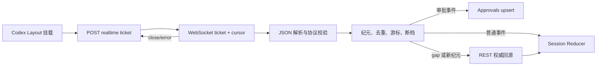
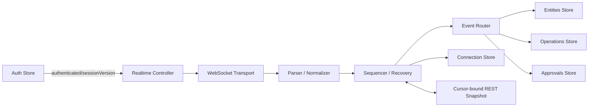

# Nuxt 状态管理与实时事件架构治理建议

> 分析日期：2026-08-11  
> 分析基线：当前工作区中的 Nuxt 4 前端代码，包含尚未提交的本地改动。  
> 分析范围：Pinia 状态、Nuxt `useState`、页面局部状态、浏览器持久化、认证会话、Codex WebSocket、事件校验与投影、REST 回源和相关测试。  
> 范围限制：后端源码不在本仓库内；涉及快照游标、事件排序和幂等关联的建议，是根据前端契约推导出的协作要求。

## 1. 结论摘要

当前前端已经形成了较清楚的状态分层：安全敏感的认证会话保存在内存 Pinia 中，跨路由的 Codex 领域状态进入 Pinia，页面提交态和弹窗态保留在组件内，主题与少量展示缓存才写入浏览器存储。这个方向是正确的，不需要更换 Pinia，也不需要把 WebSocket 实例塞进 Store。

实时链路也已经超过“收到消息直接改页面”的初级形态。现有实现具备一次性 ticket、固定协议版本、运行时校验、事件去重、游标续传、断档回源、纯 Reducer、乐观消息、内容限长和断线重连等基础能力。主要问题已经从“缺少基础设施”转为“恢复过程的一致性和状态所有权不够严格”。

建议优先处理以下四项：

1. 将认证会话和 WebSocket 生命周期绑定，终态登出时立即停连，避免清空后的 Store 被旧连接重新写入。
2. 为 REST 快照与实时事件建立一致性屏障，避免回源响应覆盖请求期间已经到达的新事件。
3. 修正流纪元切换与事件去重的顺序，并把断档恢复建模为可观察、可结束的状态机。
4. 使用 `connection.ready.heartbeat_interval` 驱动连接存活检测，区分握手超时、心跳超时、可恢复坏事件和协议版本不兼容。

随后再治理 Codex host 的双份状态、重复加载、过宽的 `loading/lastError`、session store 职责集中和投影内存回收。多标签页只保留一个 WebSocket 可以降低连接数，但不应排在正确性改造之前。

## 2. 当前状态管理模型

### 2.1 四层状态边界

| 层级               | 当前载体                                          | 典型内容                                             | 当前判断                                      |
| ------------------ | ------------------------------------------------- | ---------------------------------------------------- | --------------------------------------------- |
| 安全会话状态       | `auth` Pinia Store                                | 内存 access token、principal、角色、Scope、会话状态  | 边界合理；没有把令牌写入持久化存储            |
| 跨路由领域状态     | Pinia Stores                                      | Codex 实体投影、连接状态、审批、设备、草稿和滚动位置 | 方向合理；部分实体存在双份事实来源            |
| 页面瞬时状态       | Vue `ref/computed`                                | 提交中、弹窗、表单、错误提示、任务阶段               | 大部分合理；任务阶段已复杂到应抽成纯 selector |
| 共享派生与轻持久化 | Nuxt `useState`、`localStorage`、`sessionStorage` | 视口宽度、解析后主题、主题偏好、草稿和滚动位置       | 仅保存纯 UI 状态，并设置回收上限              |

项目没有启用 Pinia 持久化插件。刷新后的认证恢复依赖 HttpOnly refresh cookie，Codex 权威数据重新从 REST 和实时流加载。这符合“敏感凭据不落地、服务端数据可重建”的原则。

### 2.2 Store 职责盘点

| Store             | 当前职责                                                                       | 优点                                                       | 主要压力点                                                     |
| ----------------- | ------------------------------------------------------------------------------ | ---------------------------------------------------------- | -------------------------------------------------------------- |
| `app`             | 主题偏好、侧栏开关                                                             | 小而稳定                                                   | 无明显结构问题                                                 |
| `auth`            | 登录、注册、刷新、principal、权限判断、会话错误                                | 有刷新合并、`sessionVersion` 防旧请求回写、浏览器 Web Lock | 尚未直接驱动实时连接停启；跨标签只做刷新串行化                 |
| `codex-realtime`  | 连接状态、流纪元、游标、去重、断档、错误                                       | 传输状态与业务投影分离                                     | 去重先于纪元切换；恢复状态不闭环；数组查重为 O(n)              |
| `codex-session`   | host/workspace/thread/turn/item 投影、选择上下文、命令编排、快照恢复、执行策略 | 页面读取路径统一，Reducer 可测试                           | 同时承担缓存、选择、命令和恢复，职责过重；并发请求缺少代次保护 |
| `codex-approvals` | 审批实体、派生列表、逐条决策状态、实时合并                                     | 有 `version + updated_at` 乱序保护                         | Layout 与页面会重复加载；缺少请求合并和过期清理                |
| `codex-devices`   | 设备授权、host 管理、配对状态                                                  | 管理操作集中                                               | `hosts` 与 session 投影重复，实时 host 事件不会更新这里        |
| `codex-ui`        | 草稿、移动面板、时间线跟随和滚动位置                                           | 正确隔离纯 UI 状态                                         | Map 持续增长时没有清理策略                                     |

关键证据：

- `app/stores/auth.ts:43-44` 使用 WeakMap 合并初始化和刷新请求，`app/stores/auth.ts:178-195` 通过 `sessionVersion` 阻止旧刷新覆盖新会话。
- `app/stores/codex-session.ts:44-60` 将投影、选择上下文、加载状态、操作态和执行参数放入同一 Store。
- `app/stores/codex-session.ts:153-224` 手工加载并合并 host、workspace、thread。
- `app/stores/codex-devices.ts:19-20` 另行声明并保存 `hosts`，形成同一资源的第二份前端事实来源。
- `app/composables/useTheme.ts:31-65` 只将主题偏好写入 `localStorage`；会话标题和模型不再写入
  `sessionStorage`，浏览器存储仅允许保存有回收上限的草稿和滚动位置。

## 3. 当前实时事件架构

### 3.1 主链路



具体步骤如下：

1. `app/layouts/codex.vue:209` 在客户端作用域创建 `useCodexRealtime()`。
2. `app/composables/useCodexRealtime.client.ts:141-154` 先申请一次性 ticket，再根据 API origin、显式 WebSocket 基址和上次 cursor 创建 URL。
3. `app/utils/codex-event-validator.ts:201-252` 校验 envelope、协议版本、事件类型、游标和 payload，并规范化时间线、Diff 和审批对象。
4. `app/stores/codex-realtime.ts:34-66` 负责事件 ID 去重、流纪元、最后游标、断档标志和连接就绪状态。
5. `app/composables/useCodexRealtime.client.ts:104-122` 把可投影事件分发到 session 和 approvals Store。
6. `app/utils/codex-event-reducer.ts:204-384` 以纯函数方式更新标准化实体投影。
7. gap 或新 stream epoch 会触发 `app/stores/codex-session.ts:418-439` 的 REST 权威状态刷新。

### 3.2 已具备的可靠性能力

- access token 不进入 WebSocket 查询参数，连接使用一次性 ticket。
- WebSocket URL 能根据 HTTP/HTTPS 自动转换为 WS/WSS。
- 重连采用 1 秒到 30 秒的指数级区间并加入 20% jitter。
- 浏览器离线时停止立即建连，恢复在线或页面重新可见时尝试连接。
- 协议固定为 `2.0`，未知版本和未知事件类型在写 Store 前被拒绝。
- 事件 payload 会经过领域规范化器，避免 REST 和实时入口产生不同实体形态。
- Reducer 对 timeline item 进行标准化 upsert，并限制单条文本和命令输出大小。
- 断档事件不会作为业务数据进入投影，而是触发权威回源。
- 当前测试覆盖 URL 安全、显式 gap、握手就绪、非法协议关闭码、Reducer 流式拼接、快照替换、乐观项对账、协议拒绝和内容限长。

这些能力应保留。后续重构的目标是收紧顺序和职责，而不是推翻现有链路。

## 4. 主要问题与优先级

### P0-1：认证生命周期与实时连接没有形成同一个控制器

当前 Layout 调用 `useCodexRealtime()` 后没有保留其 `disconnect`。认证 Store 进入匿名、禁用、吊销或 token 重用等终态时，Layout watch 会清空 session、realtime、approvals 和 UI Store，但旧 socket 只会在 Layout 卸载时关闭。

这会产生两个问题：

- Store 清空后，尚未关闭的连接仍可能收到并重新投影事件。
- 本地 logout 已被定义为权威动作，但连接生命周期仍依赖后续路由卸载或服务端主动断开。

建议增加单一的 `CodexRealtimeController`：

- 仅在 feature enabled、认证完成且具备 `codex:read` 时连接。
- 监听 `authStore.sessionVersion` 和认证终态，立即取消重连 timer、关闭 socket、清除连接内存。
- ticket 获取中的会话发生变化时丢弃结果，不创建旧会话 socket。
- Layout 只负责启动 controller 的作用域，不再分别清 Store 和管理连接。
- Store 是否清空由明确的 `onSessionEnded` 动作统一处理。

### P0-2：REST 回源与实时写入之间没有一致性屏障

`refreshAuthority()` 会并行请求权限和 host，再请求 workspace、thread 和当前 thread snapshot。此时 WebSocket 继续投影事件。较早发出的 REST 请求如果较晚返回，可能用旧快照覆盖请求期间收到的新状态。

风险最大的路径包括：

- `loadHosts()` 整体替换 `hostsById`。
- `loadThreads()` 逐个覆盖 thread，未比较版本或 `updated_at`。
- 完整 `thread.snapshot` 会替换该线程的 timeline；请求期间收到的新 item 可能被丢弃。
- 多次 gap、新纪元、页面 mounted 和手动 resync 可同时启动多组回源请求。

最终方案需要前后端共同提供快照边界：

1. REST 快照返回 `stream_epoch` 与 `snapshot_cursor`，含义是“此快照覆盖到哪个事件”。
2. 前端开始恢复后缓冲该领域的新事件。
3. 应用快照，再按 cursor 顺序重放 `snapshot_cursor` 之后的缓冲事件。
4. 重放完成后才把恢复状态切回 `healthy` 并提交新的连接 cursor。
5. 如果 epoch 改变或缓冲溢出，放弃本轮恢复并重新拉取，不猜测状态。

在后端契约落地前，可先做过渡保护：同一资源只允许一个 in-flight 回源请求；给请求分配 generation；旧 generation 返回时不写 Store；实体合并至少比较 `version/updated_at`。这只能降低竞态，不能替代 cursor-bound snapshot。

### P0-3：纪元切换、去重与断档恢复状态不完整

`codex-realtime.acceptEvent()` 当前先执行 `seenEventIds.includes(event.event_id)`，随后才判断 `stream_epoch` 是否变化。如果新纪元重新使用旧 event ID，首个新纪元事件会被误判为 duplicate，Store 也不会切换纪元。

此外，`gapDetected` 当前只有设置路径：

- gap 时设为 `true`。
- 新纪元或全量 reset 时设为 `false`。

成功完成 `refreshAuthority()` 后没有清除它，UI 也没有消费它。也就是说，它既不是完整状态机，也不是有效用户信号。

建议改为显式恢复状态：

```ts
type CodexRecoveryStatus =
  | 'healthy'
  | 'gap_detected'
  | 'snapshot_loading'
  | 'replaying'
  | 'failed'
```

并按以下顺序接受事件：

1. 先比较 epoch；变化时原子清空旧 epoch 的 cursor 和去重窗口。
2. 再在当前 epoch 内判断 event ID 是否重复。
3. 校验事件顺序或前驱关系。
4. 更新 cursor 和去重窗口。
5. 最后投影业务事件或启动恢复。

恢复 Store 还应记录 `reason`、`startedAt`、`attempt`、`bufferedEventCount` 和最近一次成功时间，恢复成功必须有明确 transition。

### P0-4：任何坏消息都会永久关闭本次页面的实时能力

当前 `acceptMessage()` 将 JSON 解析失败、envelope 版本不兼容、某个业务 payload 字段异常全部归入同一 catch，随后设置 `protocolCompatible = false` 并使用 4002 关闭连接。这是安全的 fail-closed 策略，但故障域过大：一条可隔离的坏审批或坏时间线事件会让整个 Codex 页面停止重连。

建议把错误分成三类：

| 类别               | 示例                                     | 建议动作                                                           |
| ------------------ | ---------------------------------------- | ------------------------------------------------------------------ |
| 致命协议错误       | schema version、kind、未知事件类型不兼容 | 关闭并进入 `incompatible`，不自动重连                              |
| 流完整性错误       | cursor 倒退、缺失前驱、epoch 不可恢复    | 关闭当前连接，进入 recovery，重新快照后重连                        |
| 可隔离业务事件错误 | 某个已知事件 payload 深层字段非法        | 丢弃该事件，记录脱敏诊断，触发对应领域回源；超过阈值再升级为流错误 |

错误分类应由 validator 返回稳定错误码，而不是让 controller 根据中文 message 推断。

### P1-1：服务端心跳契约已定义但没有被使用

`connection.ready` 要求 `heartbeat_interval`，但 controller 仍使用固定 90 秒 idle timeout。服务端调整心跳频率后，前端行为不会同步；慢网络、后台标签页 timer 节流和代理 idle timeout 都可能造成误断或延迟发现。

建议区分两类 timer：

- `handshakeTimeout`：socket open 后必须在短时间内收到 `connection.ready`。
- `livenessTimeout`：ready 后按 `heartbeat_interval * 2.5` 计算，并设置合理上下限和少量 jitter；任意合法事件均可刷新活跃时间。

连接 Store 应保存协商后的 heartbeat interval、`connectedAt`、`lastHeartbeatAt` 和 `lastEventAt`。任务业务的“最后活动”不能只使用连接层 `lastMessageAt`，否则其他 host/thread 的心跳和事件会让当前任务看起来仍在推进。

### P1-2：Codex host 存在两份前端事实来源

session projection 和 devices Store 都保存 host 集合：任务与项目页面读取前者，设置页面读取后者。实时 `host.snapshot` 和 `host.status_changed` 只进入 session Reducer；rename/revoke 只直接修改 devices Store。

因此同一标签页内可能同时显示两个不同的 host 状态。建议让 host 实体只有一个 owner：

- 推荐由 `codex-entities` Store 统一持有 `hostsById`。
- devices Store 只保存 verification、设备操作状态和错误，通过 entities action 更新 host。
- session Store 只保存选择上下文、thread/turn/item 投影和命令状态，通过 getter 读取共享 host。

如果近期不拆 Store，至少建立双向适配动作，并为 REST、实时、rename、revoke 四条路径增加一致性测试。

### P1-3：请求状态过宽，重复加载与过期响应缺少治理

当前页面普遍在 `onMounted` 主动加载：Codex Layout 加载 approvals，审批页再次加载 approvals，任务详情又同时加载 approvals 和完整 authority。项目页、任务列表和项目详情也分别加载 hosts 或调用 `refreshAuthority()`。

现有 Store 没有通用的 in-flight 合并、缓存新鲜度、AbortController 或 selection generation。快速切换 host 时，旧 host 的 workspace/thread 请求可能晚于新请求返回；全局 `loading` 布尔值也无法表达“哪个资源、哪次请求、首次加载还是后台刷新”。

建议给领域查询引入小型、显式的请求状态模型，而不是立刻更换状态库：

```ts
interface AsyncResourceState {
  status: 'idle' | 'loading' | 'refreshing' | 'success' | 'error'
  requestKey: string | null
  updatedAt: number | null
  error: ApiErrorPayload | null
}
```

- Store 提供 `ensureApprovals()`、`ensureHosts()`、`ensureThreadSnapshot(threadId)`，相同 key 复用 Promise。
- 选择切换时递增 generation，响应提交前核对 generation 和当前选择。
- 页面声明需要哪些资源，不再自行拼装重复 bootstrap 顺序。
- 后台 refresh 不清空已有数据，也不显示首屏 skeleton。

### P1-4：session Store 已成为领域编排中心

`codex-session` 同时负责：

- 标准化实体投影。
- host/workspace/thread 选择。
- REST 查询与快照恢复。
- create/resume/start/steer/interrupt/compact 命令。
- 幂等键、pending operation 和乐观消息。
- 执行权限和默认参数计算。

这些职责会让任何实时一致性改造都触碰整个 Store。建议按变化原因拆分，而不是按文件大小拆分：

| 目标模块                  | 只负责                                                  |
| ------------------------- | ------------------------------------------------------- |
| `codex-entities`          | host/workspace/thread/turn/item 的标准化实体与 selector |
| `codex-context`           | selected host/workspace/thread、执行选项和可用能力      |
| `codex-operations`        | 命令提交、幂等关联、乐观状态和 operation 生命周期       |
| `codex-approvals`         | 审批实体与决策状态                                      |
| `codex-connection`        | 可序列化连接与恢复状态                                  |
| `CodexRealtimeController` | socket、timer、事件缓冲、重连和认证绑定                 |

可以分步迁移 getter 和 action，不需要一次性改完所有页面。

### P1-5：乐观消息通过文本匹配，不能精确对账

`reconcileOptimisticUserItem()` 在同一线程内查找第一条 `local-*` 且文本相同的用户消息。用户连续发送相同文本，或 steer 与新 turn 同时出现时，服务端 upsert 可能移除错误的本地项。

建议后端在最终 item 或关联事件中回传客户端提交时的 `idempotency_key` 或单独的 `client_operation_id`。前端以该字段精确替换 optimistic item；文本匹配仅保留为兼容旧协议的临时兜底，并记录命中次数。

### P1-6：投影和 UI Map 缺少总量回收

单条 timeline 内容已有 1 MiB 上限，但 `itemsById`、`turnsById`、每线程 ID 数组、草稿和滚动位置没有总量边界。长时间使用并访问大量线程后，Pinia 响应式图和 DevTools 序列化成本会持续上升。

建议：

- 当前线程保留完整已加载窗口，非当前线程只保留摘要和最近 N 条。
- 离开线程后按 LRU 或总字节预算回收 item/turn，重新进入时从快照恢复。
- 已解决审批只保留有限窗口。
- 删除/归档线程时同步清理草稿、滚动位置、history cursor 和 optimistic item。
- 去重结构改成“队列 + O(1) membership map”，并仍保持 Pinia 可序列化。

### P2：多标签页连接与跨标签会话同步

每个 Codex 标签页当前都会申请 ticket 并建立 WebSocket。`navigator.locks` 只串行化 refresh，不共享 access token、连接或事件投影；一个标签页 logout 后，其他标签页也没有立即收到本地会话终止信号。

近期先增加 `BroadcastChannel` 的认证终态广播，让其他标签立即清理内存会话并停连。只有在生产连接数、ticket 签发量或后端 fan-out 成为实际压力后，再实现“leader tab 持有 WebSocket，其他标签接收广播事件”。Leader election 必须包含租约、可见性切换和故障接管测试，不宜作为第一阶段重构。

## 5. 推荐目标架构



目标边界：

- Transport 只知道 URL、socket 和原始文本，不依赖 Pinia。
- Parser/Normalizer 是唯一外部事件契约入口，返回带错误码的判别联合。
- Sequencer 只处理 epoch、cursor、去重、缓冲和恢复，不处理业务实体。
- Event Router 根据事件类型分发到一个或多个领域 Store。
- Connection Store 只保存可观察、可序列化的状态，不保存 socket、timer、Promise 或 Set。
- REST snapshot 与事件复用同一规范化器，并携带可对齐的 stream cursor。
- 页面只消费 selector 和调用领域 command，不直接理解重连或恢复算法。

### 5.1 建议的状态所有权

| 状态                            | 唯一 owner          | 允许写入者                                            |
| ------------------------------- | ------------------- | ----------------------------------------------------- |
| access token、principal、权限   | Auth Store          | auth actions                                          |
| socket、timer、事件缓冲         | Realtime Controller | controller 内部                                       |
| 连接和恢复可见状态              | Connection Store    | controller/sequencer actions                          |
| host/workspace/thread/turn/item | Entities Store      | REST snapshot、event router、明确的 optimistic action |
| selected IDs、执行选项          | Context Store       | 用户选择、路由同步、权限重算                          |
| operation 与 optimistic 关联    | Operations Store    | command actions、operation/turn/item 事件             |
| approvals 与逐条决策状态        | Approvals Store     | REST、event router、decision actions                  |
| 草稿、面板、滚动位置            | UI Store            | 页面和组件                                            |

### 5.2 不建议做的事

- 不需要把 Pinia 替换为 Vuex 或另一个全局状态库。
- 不要把 WebSocket、timer、AbortController、Promise、Set 直接放进 Pinia state。
- 不要新增全局 event bus 绕过 Store；它会让事件顺序和写入者更难追踪。
- 不要仅靠 `updated_at` 猜测快照与事件先后；实时一致性最终需要服务端 cursor 边界。
- 不要把 access token、realtime ticket 或完整事件 payload 写入日志、`localStorage` 或错误上报。
- 不要为了消除 mounted 请求就把所有服务端数据永久缓存；应使用可失效、可回源的资源状态。

## 6. 分阶段实施方案

### 阶段一：修复连接与恢复状态机，前端可独立完成

- [ ] `acceptEvent()` 先切换 epoch，再执行当前 epoch 内去重。
- [ ] 用队列加 membership map 替换 `seenEventIds.includes()`。
- [ ] 引入 `recoveryStatus`，明确 gap 检测、加载、重放、成功和失败。
- [ ] 将 `gapDetected` 接入恢复状态或删除，避免悬空布尔值。
- [ ] 保存并使用服务端 `heartbeat_interval`，增加握手超时。
- [ ] validator 输出稳定错误类别和错误码。
- [ ] 认证终态、sessionVersion 变化和 Layout 卸载都通过同一 controller `stop()`。
- [ ] ticket 请求和 socket open 都校验启动时的 sessionVersion。
- [ ] approvals 和 authority 加 in-flight 合并，先消除明显重复请求。

阶段验收：

- 新 epoch 复用旧 event ID 时仍能切换并投影。
- gap 回源成功后状态回到 healthy；失败时可重试且不会伪装为已连接。
- logout 后 socket 立即关闭，后续旧事件不能重新填充 Store。
- 单个已知业务事件 payload 异常不会永久禁用全部实时能力。
- 心跳频率改变后，前端超时阈值随握手结果变化。

### 阶段二：建立快照与事件一致性，需要后端协作

- [ ] 为 host/workspace/thread/approval 快照返回 `stream_epoch` 和 `snapshot_cursor`。
- [ ] 明确 cursor 是否全局、按用户、按 host 或按领域排序，并写入协议文档。
- [ ] 恢复期间缓冲事件，快照后按 cursor 重放。
- [ ] 协议增加 `prev_cursor` 或单调 sequence，使客户端能检测未显式报告的断档。
- [ ] item 事件回传 `client_operation_id`，替代文本乐观对账。
- [ ] REST 和 WebSocket 对同一实体共享版本、时间和删除语义。
- [ ] 重复 gap 合并为单次 recovery，缓冲上限溢出时重新快照。

阶段验收：

- 快照请求期间到达的 item、turn 和 approval 事件最终恰好应用一次。
- 延迟返回的旧快照不能把 active thread、host status 或已解决审批回滚。
- 连续断网、服务端 stream trim、epoch 重建后，UI 最终与权威快照一致。
- 相同文本的连续消息可以精确替换各自 optimistic item。

### 阶段三：收紧 Store 所有权与资源生命周期

- [ ] 统一 session 和 devices 中的 host 实体。
- [ ] 将 session Store 按 entities、context、operations 三个变化原因迁移。
- [ ] 把任务 phase 提取为纯 selector，页面顶部、工作指示、操作区使用同一结果。
- [ ] 使用 `AsyncResourceState` 表达首次加载、后台刷新和错误。
- [ ] 给 host selection 和 thread snapshot 增加 request generation 或取消机制。
- [ ] 为 item、turn、approval、draft 和滚动位置设置回收预算。
- [ ] 补充脱敏实时指标；根据生产数据决定是否做多标签 leader。

阶段验收：

- 任一核心实体只有一个前端 owner。
- 页面切换不再重复发起相同 approvals/hosts 请求。
- 快速切换 host 或 thread 时旧响应不会污染当前选择。
- 长时间浏览大量线程后，投影实体数和内存占用保持在预算内。

## 7. 测试补强矩阵

| 层级                | 必测场景                                                                                 |
| ------------------- | ---------------------------------------------------------------------------------------- |
| Realtime Store 单测 | 同 epoch 重复、新 epoch 同 ID、去重窗口淘汰、gap 状态转换、恢复成功清理                  |
| Validator 单测      | fatal/recoverable/event-local 三类错误、深层 payload、未知版本、敏感字段不进入错误文本   |
| Controller 组件测试 | ticket 失败、握手超时、动态心跳、offline/online、visibility、logout、会话切换、卸载清理  |
| Sequencer 单测      | 快照期间缓冲、cursor 排序、重复事件、epoch 变化、缓冲溢出、恢复重入                      |
| Entities/Store 单测 | 旧 REST 响应不回滚新事件、host 单一事实来源、精确 optimistic 对账、资源回收              |
| 页面测试            | loading 与 refreshing 区分、recovery banner、审批角标、任务 phase 单一 selector          |
| E2E                 | 执行中断网重连、gap 后恢复、登出立即停连、两标签登出同步、Agent 重启和 stream epoch 变化 |

当前 `tests/nuxt/codex-realtime.spec.ts` 只有 4 个主要用例，覆盖了基础连接但尚未覆盖 close 后重连、timer、logout、gap 回源成功和竞态。`tests/unit/codex-event-reducer.test.ts` 对实体投影覆盖较好，可以保留为重构时的回归基线。

## 8. 可观测性建议

建议记录聚合指标和脱敏上下文，不记录 ticket、access token、完整命令、消息正文或原始事件 payload：

| 指标                                              | 用途                                               |
| ------------------------------------------------- | -------------------------------------------------- |
| `codex_realtime_connect_total{result}`            | 连接、ticket、握手总体成功率                       |
| `codex_realtime_ready_latency_ms`                 | 从申请 ticket 到 ready 的耗时                      |
| `codex_realtime_reconnect_total{reason}`          | 网络、idle、server close、协议错误的分布           |
| `codex_realtime_gap_total{reason}`                | stream trim、cursor 无效和客户端检测断档           |
| `codex_realtime_recovery_duration_ms{result}`     | 权威恢复耗时和失败率                               |
| `codex_realtime_event_rejected_total{class,type}` | 契约异常趋势，不含 payload                         |
| `codex_realtime_duplicate_total{type}`            | 重放和服务端重复发布情况                           |
| `codex_projection_entities{kind}`                 | host/thread/turn/item/approval 数量和回收效果      |
| `codex_snapshot_discarded_total{reason}`          | generation、epoch 或 cursor 不匹配导致的旧响应丢弃 |

客户端日志至少附带 route、stream epoch 的不可逆摘要、事件 type、恢复 attempt 和 request ID。event ID、thread ID 等标识是否上报，应遵循现有隐私和日志规范；默认可做摘要而非原值。

## 9. 建议形成的架构决策记录

为避免后续再次出现多种事实来源，建议把下列决定写成简短 ADR：

1. `ADR-状态所有权`：Pinia 负责哪些长期状态，页面局部状态和浏览器存储允许保存什么。
2. `ADR-实时协议顺序`：epoch、cursor、event ID、prev cursor、快照边界和删除事件的语义。
3. `ADR-恢复状态机`：什么错误停连，什么错误回源，何时认为恢复完成。
4. `ADR-乐观操作关联`：idempotency key、client operation、command、turn 和 item 的关联方式。
5. `ADR-投影保留策略`：实体数量、字节预算、LRU 和重新加载行为。

## 10. 最终建议

当前架构不需要“大换栈”。Pinia、纯 Reducer、运行时事件校验和一次性 ticket 都应继续使用。近期投入应集中在三个协议级边界：认证何时拥有连接、快照覆盖到哪个事件、恢复何时真正完成。

实施顺序建议固定为：先绑定连接生命周期并补齐恢复状态机，再建立 cursor-bound snapshot，最后拆分 Store 和做内存优化。这样每一步都能通过可观察状态和自动化测试独立验收，也能避免在状态所有权尚未稳定时过早引入查询库、事件总线或多标签 leader election。

## 11. 2026-08-15 会话状态所有权回归

### 11.1 领域状态

会话索引的唯一事实源是服务端 `codex_thread_index` 投影。`codex-session` 负责 host、workspace、
conversation 实体、键集分页、搜索、归档、置顶和当前选择；`codex-devices` 不再维护第二份 host 投影。
会话标题、`recency_at` 和 `is_pinned` 均由服务端返回并在 Reducer 中按版本和来源优先级合并，不能用
同步时间或 sessionStorage 覆盖。

`codex-approvals` 是待审批数量和审批状态的唯一所有者；会话内卡片和审批中心只消费同一 Store。
`codex-ui` 只持有上下文模式、移动 Remote 层级、草稿和滚动位置，不保存业务索引或审批副本。

### 11.2 实时与回收边界

实时事件遵循公共头字段和强类型 detail，校验 `kind`、`schema_version`、`detail_kind` 后才进入 Reducer。
未知事件或坏 detail 只能隔离单条条目并触发权威回源，不能清空整个会话 Store。epoch、cursor、
generation、route 变更会丢弃旧响应；关闭页面、切换 host、退出登录统一停止 WebSocket、timer 和
恢复任务，清理滚动锁、上下文选择和临时草稿。

### 11.3 生产验证

前端 `pnpm verify` 的格式、ESLint、Nuxt typecheck、Vitest 167 项、覆盖率、构建和 Playwright 9 项均
通过。真实桌面和手机视口均验证单一项目/会话导航、审批数量、会话正文、固定 Composer 和上下文页，
无横向溢出与资源残留。生产镜像使用显式 env-file、项目名和 Caddy overlay 更新，数据卷保持原样。
